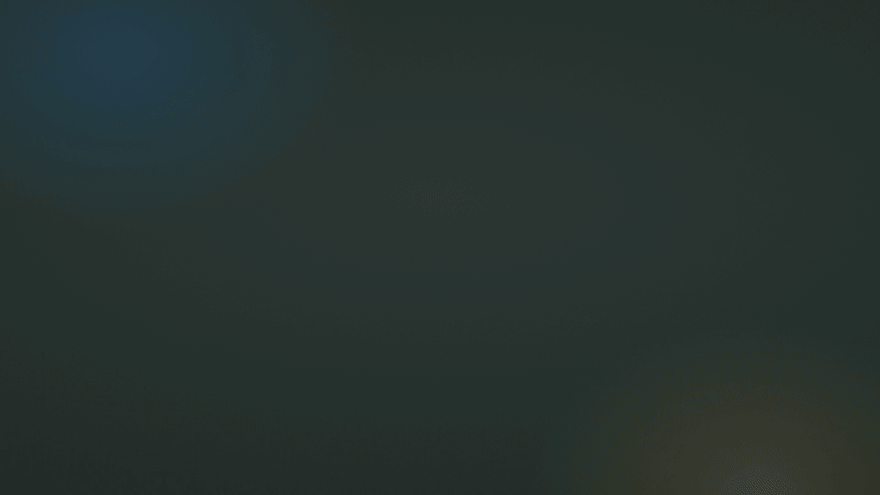

# Portlight

See which localhost ports are in use, by which project, and which are free, from a
Chrome toolbar button.

[](assets/video/portlight-launch.mp4)

[Watch the 34-second launch video with sound](assets/video/portlight-launch.mp4)

- Every listener, with its port, project folder, recognised tool (Vite, Next.js, Uvicorn…), process and
  uptime. Servers reachable from your network are marked.
- Type a port to see whether it's free; the footer always offers the nearest free one.
- Quit a stray dev server from the popup (it asks first, and only for your own processes), or every idle one
  at once.
- Open on Phone shows a QR code for your LAN address. Share Public Link starts a cloudflared (or ngrok)
  tunnel when one is installed.

Works in Chrome, Chromium, Brave, Edge, Arc and Vivaldi on macOS, Linux and Windows.

## Install

1. Add Portlight to your browser from the Chrome Web Store.
2. Install the small helper it uses to read ports. You need
   [Node.js](https://nodejs.org) 18 or newer.

   ```sh
   npx portlight-host install
   ```

   On macOS or Linux you can use Homebrew instead:

   ```sh
   brew install maero47/tap/portlight-host
   portlight-host install
   ```

3. Open the Portlight popup. If it was already open, close it and open it again.

On Windows without Node.js, run `winget install OpenJS.NodeJS.LTS` first, then open a
new terminal for step 2.

The helper registers itself with every Chromium browser it finds and needs no admin
rights. `portlight-host status` shows what is installed and whether it works, and
`portlight-host uninstall` removes it. More in the [helper's README](host/README.md).

### From source

To run the extension from this repository on macOS or Linux:

```sh
./install.sh
```

It builds the extension and installs the helper for it. Then open `chrome://extensions`,
turn on Developer mode, click Load unpacked and pick `extension/dist`. The unpacked build
has a fixed ID, so the order of the two steps doesn't matter. After pulling updates, run
`./install.sh` again and click the reload arrow on the Portlight card. To uninstall, run
`./install.sh --uninstall` and remove the extension.

On Windows, build with `cd extension && npm ci && npm run build`, run
`powershell -ExecutionPolicy Bypass -File host\install.ps1`, and load `extension\dist`
the same way.

## How it works

```
popup ──connectNative──▶ helper (Node, runs as you) ──▶ lsof / ss / netstat
```

Chrome can't see which process owns a port, so the extension talks to a native
messaging helper over stdin/stdout ([protocol](shared/protocol.ts)). While the popup is
open it keeps one helper process and asks it for the list every two seconds; the helper
exits when the popup closes. The toolbar badge is refreshed every 30 seconds.

- [`extension/`](extension/README.md): Manifest V3 popup and badge worker (TypeScript, no framework)
- [`host/`](host/README.md): the helper, using `lsof` on macOS, `ss` or `/proc` on Linux, `netstat` on Windows
- [`assets/`](assets/README.md): icons and store artwork

Without the helper, the popup can still knock on common dev ports over HTTP, clearly
labelled "HTTP only".

## Privacy

Nothing leaves your computer. There is no account, analytics or remote server.

- The helper only reads local socket and process tables, and only answers Portlight
  (its manifest lists Portlight's extension IDs and nothing else).
- The extension's only web access is `http://localhost`, `127.0.0.1`, `[::1]` and `*.localhost`: the HTTP
  fallback, tab linking, and each local server's favicon and page title.
- Share Public Link is the one exception, and only when you click it: it exposes that server to anyone with
  the link through Cloudflare (or ngrok) until you stop it, the server stops, or the browser quits.
- Quitting a process asks first, and the helper refuses anything that isn't yours or isn't
  holding a listening port, and never touches the browser itself.

The full privacy policy is in [PRIVACY.md](PRIVACY.md).

## Development

```sh
cd host && npm test                      # parsers, handler, installer on every OS, a real TCP server
cd extension && npm test                 # unit tests + popup against a mocked helper
cd extension && npm run test:e2e:real    # real install, real helper, real servers in Chromium
cd extension && npm run store:shots      # regenerate assets/store/screenshot-*.png
```

Playwright needs Chromium once: `cd extension && npx playwright install chromium`.

### Extension ID

`extension/src/manifest.json` carries a public `key`, which pins the ID to
`mfnkpeccejhabclngfmkadokknojffeo` (print it with `node extension/scripts/extension-id.mjs`).
The matching private key lives in `.keys/portlight-extension.pem`, which is gitignored and
only needed to pack a `.crx`. Keep a copy somewhere safe:

```sh
node extension/scripts/keygen.mjs --from path/to/portlight-extension.pem   # restore the key in the manifest
node extension/scripts/keygen.mjs                                           # new key pair = new ID
```

A new ID means everyone re-runs `./install.sh`. The Chrome Web Store build has its own
ID, `khdojfoihgghehobdalaonjocjmolfjk`, which the helper allows by default (see
`host/src/ids.js`).

### Releasing the helper

```sh
cd host && npm publish                  # publishes portlight-host to npm
packaging/homebrew/bump.sh              # point the formula at the new version
```

Then copy `packaging/homebrew/portlight-host.rb` to `Formula/` in the `maero47/homebrew-tap`
repository. See [packaging/homebrew](packaging/homebrew/README.md).
