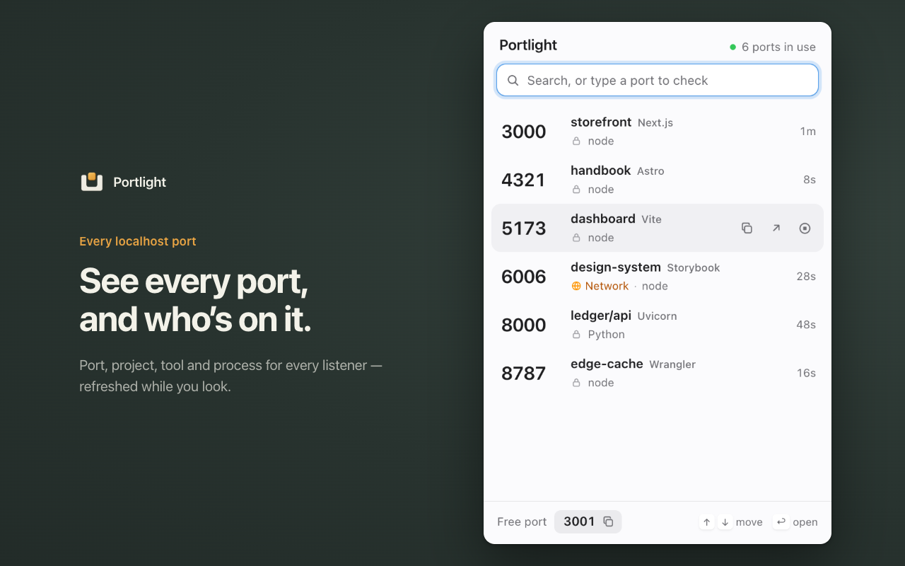

# Portlight

See which localhost ports are in use, by which project, and which are free — from a
Chrome toolbar button.



- **Every listener:** port, project folder, recognised tool (Vite, Next.js, Uvicorn…), process and uptime.
  Servers reachable from your network are marked.
- **Type a port** to see whether it's free; the footer always offers the nearest free one.
- **Quit** a stray dev server from the popup (asks first; only your own processes).

Works in Chrome, Chromium, Brave, Edge, Arc and Vivaldi on macOS, Linux and Windows.

## Install

You need [Node.js](https://nodejs.org) 18 or newer.

1. In this folder, run:

   ```sh
   ./install.sh
   ```

   It builds the extension and installs the small helper Portlight uses to read ports.
2. Open `chrome://extensions`, turn on **Developer mode**, click **Load unpacked** and pick
   `extension/dist`.

That's it. The extension ID is fixed, so the order of the two steps doesn't matter and
you never need to copy an ID. After pulling updates, run `./install.sh` again and click
the reload arrow on the Portlight card.

Uninstall: `./install.sh --uninstall`, then remove the extension.

**Windows:** build with `cd extension && npm ci && npm run build`, then run
`powershell -ExecutionPolicy Bypass -File host\install.ps1 mfnkpeccejhabclngfmkadokknojffeo`
and load `extension\dist` as above.

## How it works

```
popup ──connectNative──▶ helper (Node, runs as you) ──▶ lsof / ss / netstat
```

Chrome can't see which process owns a port, so the extension talks to a native
messaging helper over stdin/stdout ([protocol](shared/protocol.ts)). While the popup is
open it keeps one helper process and asks it for the list every two seconds; the helper
exits when the popup closes. The toolbar badge is refreshed every 30 seconds.

- [`extension/`](extension/README.md) — Manifest V3 popup and badge worker (TypeScript, no framework)
- [`host/`](host/README.md) — the helper: `lsof` on macOS, `ss` or `/proc` on Linux, `netstat` on Windows
- [`assets/`](assets/README.md) — icons and store artwork

Without the helper, the popup can still knock on common dev ports over HTTP, clearly
labelled "HTTP only".

## Privacy

Nothing leaves your computer. There is no account, analytics or remote server.

- The helper only reads local socket and process tables, and only answers this extension
  (its manifest lists this extension's ID and nothing else).
- The extension's only web access is `http://localhost` and `http://127.0.0.1`, used by
  the HTTP fallback.
- Quitting a process asks first, and the helper refuses anything that isn't yours or isn't
  holding a listening port — including the browser itself.

## Development

```sh
cd host && npm test                      # parsers, handler, installer, a real TCP server
cd extension && npm test                 # unit tests + popup against a mocked helper
cd extension && npm run test:e2e:real    # real install, real helper, real servers in Chromium
cd extension && npm run store:shots      # regenerate assets/store/screenshot-*.png
```

Playwright needs Chromium once: `cd extension && npx playwright install chromium`.

### Extension ID

`extension/src/manifest.json` carries a public `key`, which pins the ID to
`mfnkpeccejhabclngfmkadokknojffeo` (print it with `node extension/scripts/extension-id.mjs`).
The matching private key lives in `.keys/portlight-extension.pem`, which is gitignored and
only needed to pack a `.crx`. Keep a copy somewhere safe:

```sh
node extension/scripts/keygen.mjs --from path/to/portlight-extension.pem   # restore the key in the manifest
node extension/scripts/keygen.mjs                                           # new key pair = new ID
```

A new ID means everyone re-runs `./install.sh`. The Chrome Web Store assigns its own ID;
`./install.sh <store-id>` allows that one too.
